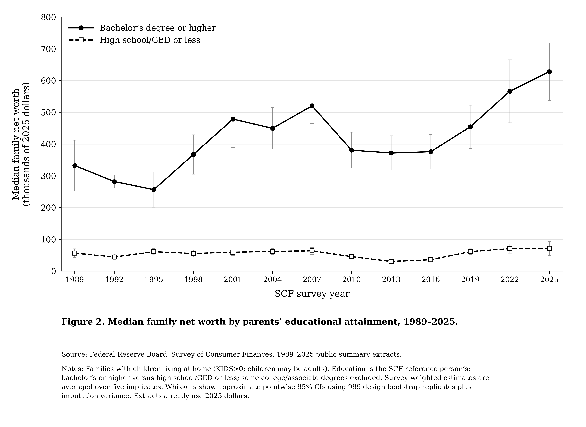

# POLISCI 158: U.S. family wealth gap, 1989–2025

Reproduces the course’s wealth-by-parents’-education figure using **weighted median family net worth**, selected to describe a typical family.
Data: original [Federal Reserve Survey of Consumer Finances](https://www.federalreserve.gov/econres/scfindex.htm) public summary extracts, all 13 waves from 1989–2025.
Sample: families with children at home, including adult children; reference person’s bachelor’s-or-higher education versus high school/GED or less; some college excluded.
The extracts already use **2025 dollars**. Estimates average survey-weighted statistics across five implicates; whiskers incorporate survey-design and imputation uncertainty.
Reproduce: `python -m pip install -r requirements.txt`, then `python get_data.py` and `python plot.py` (writes `figure.png`).
[Detailed methods](METHODOLOGY.md) and [results/validation](RESEARCH_REPORT.md).

